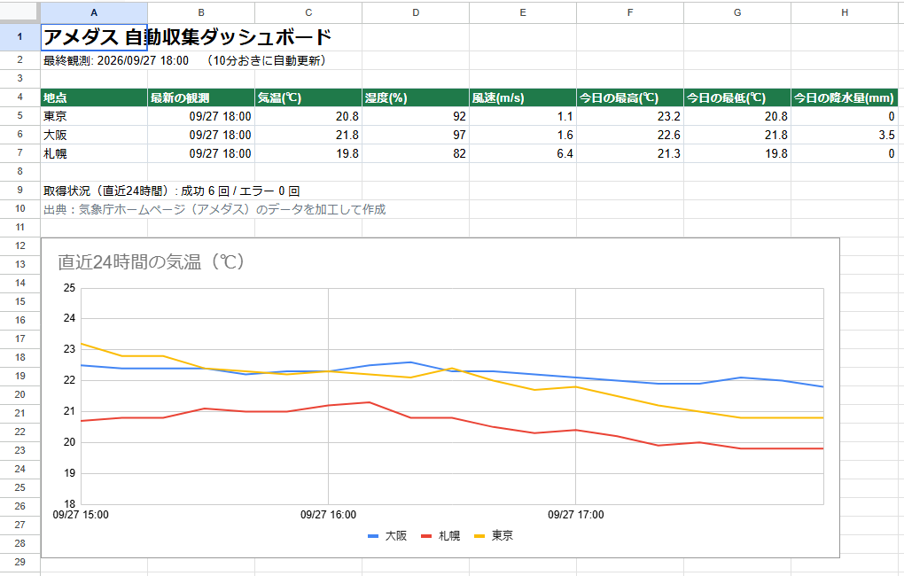
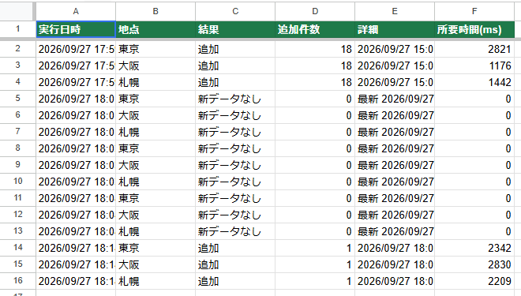
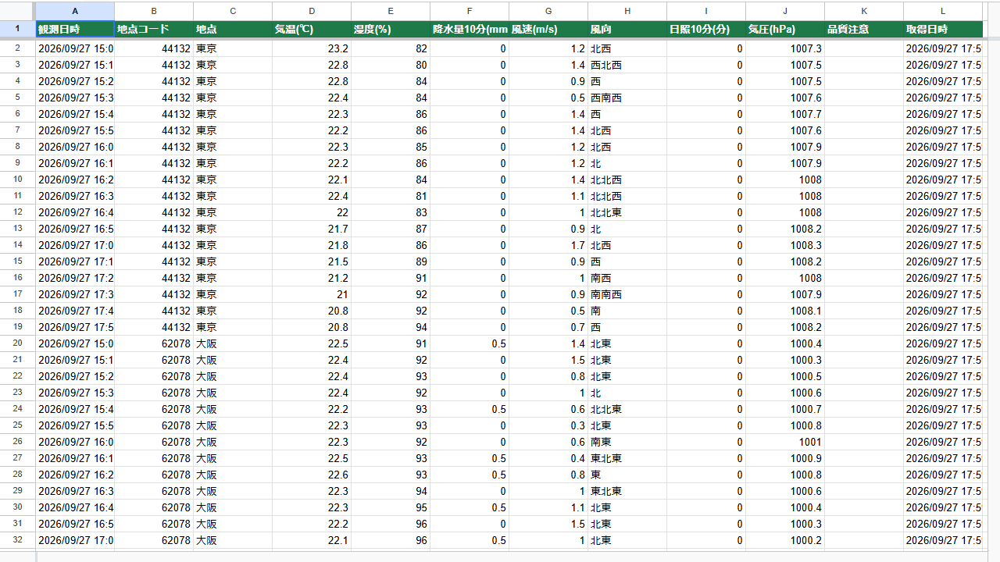

# アメダス自動収集 → Googleスプレッドシート

気象庁アメダスの10分ごとの観測値を **10分おきに自動取得** し、Googleスプレッドシートに時系列で蓄積して、ダッシュボードで可視化する Google Apps Script です。
サーバーやパソコンの常時起動は不要で、Google のトリガーだけで24時間動きます。

## 実際の画面

ダッシュボード（最新値・今日の最高/最低・直近24時間の気温グラフ・取得の成功/エラー回数）

ログ（初回は3時間ぶんの18件をまとめて取得し、その後は10分ごとに1件ずつ追加。新しい観測がまだ出ていない回は「新データなし」）

データ（1観測1行で蓄積）

## できること

| 機能 | 内容 |
|---|---|
| 定期収集 | 10分おきのトリガーで、東京・大阪・札幌の最新観測（気温・湿度・降水量・風速・風向・日照・気圧）を取得 |
| 時系列の蓄積 | 「データ」シートに1観測1行で追記（観測日時は日付型） |
| 重複の防止 | 記録済みの最新時刻を、スクリプトの記憶とシート末尾の両方から判定。二重実行も LockService で防止 |
| 取りこぼしの補完 | 停止などで間が空いた場合、最大24時間ぶんさかのぼって欠けた時刻を埋める |
| 欠測・品質の検知 | 値がない項目は「欠測」、品質フラグが正常でない項目は「要確認」として行に記録 |
| エラー処理 | 一時的な通信エラーは待ってから再試行。1地点が失敗しても他の地点は続行し、「ログ」シートに記録 |
| ダッシュボード | 地点ごとの最新値、今日の最高・最低気温と降水量、直近24時間の気温グラフ、直近24時間の成功・エラー回数 |
| 日別まとめ | 日付×地点の最高・最低気温、降水量合計を QUERY 関数で自動集計 |

## シート構成

- **ダッシュボード**：最新値の表と24時間グラフ
- **データ**：観測日時 / 地点コード / 地点 / 気温 / 湿度 / 降水量10分 / 風速 / 風向 / 日照10分 / 気圧 / 品質注意 / 取得日時
- **ログ**：実行日時 / 地点 / 結果（追加・新データなし・エラー） / 件数 / 詳細 / 所要時間
- **グラフ用**：グラフの元データ（直近24時間の時刻×地点）と日別まとめ

## 使い方

1. Googleスプレッドシートを新規作成し、「拡張機能」→「Apps Script」を開く
2. `Code.gs` の内容を貼り付けて保存する
3. 関数 `setup` を選んで実行し、権限を許可する
   - シート作成、ダッシュボード作成、初回の取得、10分おきのトリガー登録までを自動で行います
4. 止めるときは関数 `removeTriggers` を実行する

地点を増やすときは、`CONFIG.stations` に地点コードを追加します（地点コードは気象庁のアメダス地点一覧に準拠）。

## アクセスへの配慮

- 取得するのはログイン不要の公開データのみ
- 1回の実行で、最新時刻の確認1回＋地点ごとに1回（補完が必要なときだけ追加）の少ない通信にし、リクエストの間隔もあけています
- 出典をダッシュボードに表示しています（政府標準利用規約に準拠）

## テスト

`test/run_test.js` で、Apps Script の機能を模したオブジェクトを使い、実際の気象庁データに対して次を確認しています（Node.js で `node test/run_test.js`）。

- 日時・ブロック計算（月末・年末をまたぐ場合を含む）
- 初回取得／続けて実行しても重複しない
- 9時間分の取りこぼしを前のブロックから補完できる
- スクリプトの記憶が消えても、シートから復元して重複しない
- 1地点が HTTP 500 で失敗しても、エラーを記録して他の地点は続行する

出典：気象庁ホームページ（アメダス）のデータを加工して作成
